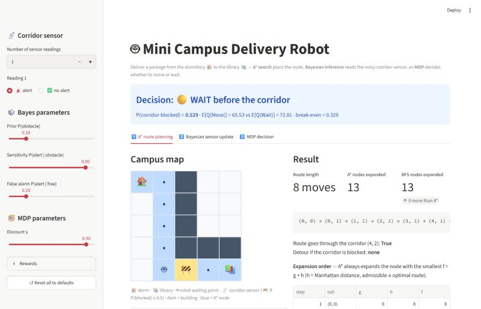

# Mini Campus Delivery Robot — AI Fundamentals Final Project (Topic 02)

A simulated robot carries a package from the dormitory (S) to the library (G) across a small campus.
Three course algorithms work toward one goal — **deliver the package quickly without crashing**:

| # | Algorithm | Question it answers | Output |
|---|-----------|---------------------|--------|
| 1 | **A\* search** | Which way should I go? | 8-move route through the corridor |
| 2 | **Bayesian inference** | The corridor sensor beeped — is it really blocked? | P(obstacle) = 0.529 |
| 3 | **MDP (value iteration / Bellman)** | Given that probability, Move or Wait? | WAIT (MOVE if no alert) |

**How they connect:** A\* shows the route must pass one corridor cell `C = (4,2)` and that no detour exists
(A\* with `C` removed finds no path). So the robot needs to know if `C` is blocked → Bayes. Bayes gives
a probability, not a certainty → the MDP turns that probability into the best action.



## Run

```bash
pip install -r requirements.txt
python campus_robot.py      # console demo (standard library only)
streamlit run app.py        # interactive web UI → http://localhost:8501
python -m pytest -v         # 37 tests (algorithms, pipeline, UI)
```

**Web UI features:** colour-coded campus map with the A\* route, a click-to-edit map (add or remove buildings),
1–5 sensor readings, sliders for the prior, sensor accuracy, γ and rewards, the A\* expansion table with a BFS comparison,
a step-by-step Bayes table and chart, and the Q-table with an E[Q] vs. belief chart.

## Project structure

| Path | Content |
|---|---|
| `campus_robot.py` | A\*, BFS baseline, Bayes (single and sequential), value iteration, decision, console demo |
| `app.py` | Streamlit web interface |
| `tests/` | `test_campus_robot.py` (31 unit and integration tests), `test_app.py` (6 UI tests) |
| `docs/Technical_Report.md` | Technical report: methods, results, sensitivity analysis, limitations |
| `docs/AI_Usage_Declaration.md` | AI usage declaration |
| `docs/Team_Contribution.md` | Team contribution statement |
| `docs/Demo_Video_Script.md` | Script for the 2–3 minute demo video |
| `sample_output.txt` | Full console run |

## Setup and assumptions (toy values)

```
S . # . .      S = start (dorm)      # = wall (2 wall segments)
. . # . .      G = goal (library)    C = corridor cell with a sensor
. . # . .
. . # # #
. . C . G
```

- Grid 5×5, 4-directional moves, each move costs 1.
- Prior P(obstacle in corridor) = 0.20. Sensor: P(alert | obstacle) = 0.90, P(alert | free) = 0.20.
- MDP states: Clear, Blocked. Actions: Move, Wait. γ = 0.9.

| Rewards | Move | Wait |
|---|---|---|
| Clear | +10 | −2 |
| Blocked | −20 | −1 |

| Transitions | → Clear | → Blocked |
|---|---|---|
| Clear, any action | 0.9 | 0.1 |
| Blocked, Move | 0.2 | 0.8 |
| Blocked, Wait | 0.6 | 0.4 |

## 1. A\* search

- **Input:** grid, walls, start (0,0), goal (4,4).
- **Key step:** always expand the node with the smallest `f = g + h`, where `g` = steps taken, `h` = Manhattan distance to the goal.
  Manhattan distance never overestimates on a 4-direction grid (admissible), so the route is guaranteed shortest.
- **Output:** `(0,0) → (0,1) → (1,1) → (2,1) → (3,1) → (4,1) → (4,2) → (4,3) → (4,4)`, 8 moves, 13 nodes expanded.
- **Why A\*:** finds the shortest path but expands fewer nodes than BFS/UCS thanks to the heuristic.

## 2. Bayesian inference

- **Input:** prior 0.20, observation = `alert`.
- **Key step:** `P(Obs | alert) = P(alert | Obs)·P(Obs) / P(alert) = 0.9·0.2 / (0.9·0.2 + 0.2·0.8) = 0.18 / 0.34`
- **Output:** P(obstacle) = **0.529** (and 0.030 if the sensor is silent).
- **Why Bayes:** the sensor is noisy — an alert raises the probability from 20% to 53%, but does not prove the corridor is blocked.

## 3. MDP

- **Input:** states, actions, transitions, rewards, γ = 0.9, belief from step 2.
- **Key step:** Bellman update `Q(s,a) = R(s,a) + γ Σ T(s'|s,a)·V(s')`, repeated until V stops changing (value iteration).
  First iteration (one-step expected reward) equals R. Converged values:

  | | Q(Move) | Q(Wait) | best |
  |---|---|---|---|
  | Clear | 86.44 | 74.44 | Move |
  | Blocked | 46.94 | 71.37 | Wait |

  The robot doesn't know the true state, so it weights Q by the Bayes probability:
  `E[Q(a)] = P(Blocked)·Q(Blocked,a) + P(Clear)·Q(Clear,a)`

- **Output (alert):** E[Q(Move)] = 65.53, E[Q(Wait)] = 72.81 → **WAIT**.
  **Output (no alert):** 85.24 vs 74.34 → **MOVE**.
  Break-even: Move is better only while P(Blocked) < 0.329.
- **Why MDP:** it compares actions by long-term expected reward, not just the immediate one, and accounts for the corridor changing over time.

## Sample output

See `sample_output.txt` (full console run).

## Evaluation

- A\* returns the optimal 8-move path; removing the corridor correctly yields "no path".
- Bayes posterior matches the hand calculation (0.18 / 0.34 = 0.529).
- Decision is sensible: with an alert, the risk of −20 outweighs the gain of +10, so the robot waits; without one, it moves.

## Possible improvements

- Use repeated sensor readings (sequential Bayes / HMM filtering) instead of one reading.
- Solve a full POMDP instead of weighting MDP Q-values by belief (QMDP approximation).
- Larger map with several uncertain corridors; replan with A\* using expected cost of each cell.
- Simple visualization (matplotlib animation) of the robot moving.
