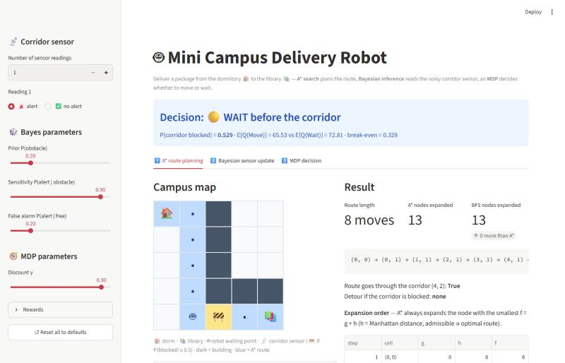
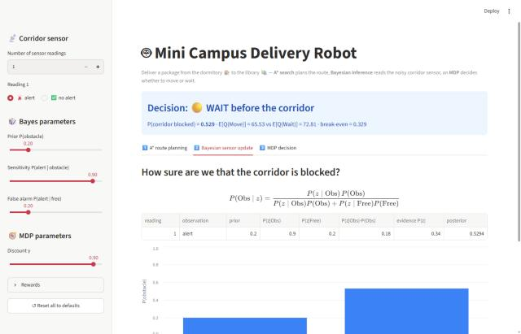
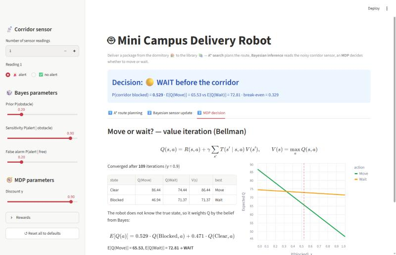

# Mini Campus Delivery Robot — Technical Report

**Course:** AI Fundamentals — Final Project (Topic 02)
**Team:** Nisanbaev Madiyar · Altynbekuly Temirlan · Temirtasov Sultankhan · Baizhanov Esmankhan
**Repository:** https://github.com/lawrensesqq/campus-delivery-robot

---

## 1. Problem statement

Small delivery robots are starting to move packages around university campuses, from dormitories to libraries,
cafeterias and offices. On such a route a robot faces three questions:

1. **Where should I go?** It needs the shortest route on a map with buildings in the way.
2. **Is the way ahead free?** Narrow passages are often blocked by people or carts, and the robot's sensors are noisy.
3. **What should I do now?** Driving into a blocked passage can damage the package, while waiting too long makes the delivery late.

Our project models this situation on a small 5×5 campus map. The robot carries a package from the dormitory (S) to the
library (G). The only gap between two buildings is a narrow corridor cell `C = (4,2)`, and that cell has a proximity sensor.

```
S . # . .      S = start (dormitory)     # = building (wall)
. . # . .      G = goal (library)        C = corridor cell with a sensor
. . # . .
. . # # #
. . C . G
```

## 2. Objectives

- Plan an **optimal** route with an informed search algorithm.
- Estimate the probability that the corridor is blocked from a **noisy** sensor reading.
- Choose the action (**Move** or **Wait**) that maximises long-term expected reward under that uncertainty.
- Connect the three parts into one pipeline, so that each algorithm's output becomes the next one's input.
- Provide an interactive interface, automated tests and documentation.

## 3. System overview

```
 campus map ──► [1] A* search ──► route + "must pass corridor, no detour"
                                              │
 sensor reading(s) ──► [2] Bayes rule ──► P(corridor blocked)
                                              │
 rewards, transitions ──► [3] MDP value iteration ──► Q(s,a) ──► E[Q] under belief ──► MOVE / WAIT
```

| # | AI topic | Algorithm | Question it answers | Output (default scenario) |
|---|---|---|---|---|
| 1 | Search | A\* with Manhattan heuristic | Which way? | 8-move route through `C`. No detour exists |
| 2 | Probabilistic reasoning | Bayes' rule (sequential update) | Is `C` blocked? | P = 0.529 after an alert, 0.030 without one |
| 3 | Decision making under uncertainty | MDP, Bellman equation, value iteration | Move or Wait? | WAIT after an alert, MOVE without one |

## 4. Methods

### 4.1 A\* search

- **State:** a grid cell `(row, col)`. **Actions:** 4 moves (down, right, up, left). **Step cost:** 1.
- **Evaluation function:** `f(n) = g(n) + h(n)`. Here `g` is the number of steps taken so far, and `h` is the Manhattan distance `|Δrow| + |Δcol|` to the goal.
- **Admissibility:** with 4-directional moves of cost 1, the robot needs at least `|Δrow| + |Δcol|` moves. So `h` never overestimates, and A\* returns an optimal path. Our tests verify this for every reachable cell, using BFS distances as the ground truth.
- **Implementation:** a priority queue (`heapq`) ordered by `(f, g, cell)`, a closed set, and `came_from` for path reconstruction.
- **Result:** `(0,0) → (0,1) → (1,1) → (2,1) → (3,1) → (4,1) → (4,2) → (4,3) → (4,4)`, 8 moves, 13 nodes expanded.
- **Key finding:** when `C` is added to the blocked set, A\* returns *no path*. The robot cannot reroute, so it has to reason about the corridor.

### 4.2 Bayesian inference

- **Hypotheses:** Obstacle / Free. **Prior:** P(Obstacle) = 0.20.
- **Sensor model:** P(alert | Obstacle) = 0.90 (sensitivity), P(alert | Free) = 0.20 (false alarms, for example people walking by).
- **Update:**

  P(Obs | z) = P(z | Obs)·P(Obs) / [P(z | Obs)·P(Obs) + P(z | Free)·P(Free)]

- **Alert:** 0.9·0.2 / (0.9·0.2 + 0.2·0.8) = 0.18 / 0.34 = **0.529**.
- **No alert:** 0.1·0.2 / (0.1·0.2 + 0.8·0.8) = 0.02 / 0.66 = **0.030**.
- **Several readings:** each posterior becomes the prior for the next reading. Two alerts give 0.835. An alert followed by silence gives 0.123.

### 4.3 Markov Decision Process

- **States:** Clear, Blocked. **Actions:** Move, Wait. **Discount:** γ = 0.9.

| Reward R(s,a) | Move | Wait |
|---|---|---|
| Clear | +10 (progress) | −2 (wasted time) |
| Blocked | −20 (collision) | −1 (small delay) |

| Transition T(s'\|s,a) | → Clear | → Blocked |
|---|---|---|
| Clear, any action | 0.9 | 0.1 |
| Blocked, Move | 0.2 | 0.8 |
| Blocked, Wait | 0.6 | 0.4 |

- **Bellman update:** `Q(s,a) = R(s,a) + γ Σ_s' T(s'|s,a) V(s')`, `V(s) = max_a Q(s,a)`. The update repeats until `max |ΔV| < 10⁻⁴`, which takes 109 iterations.

| | Q(Move) | Q(Wait) | Optimal |
|---|---|---|---|
| Clear | 86.44 | 74.44 | Move |
| Blocked | 46.94 | 71.37 | Wait |

- **Acting under uncertainty:** the robot does not observe the true state, so it weights the Q-values by its Bayesian belief *b* = P(Blocked):

  E[Q(a)] = b·Q(Blocked, a) + (1 − b)·Q(Clear, a)

  This is the **QMDP approximation** of a POMDP.
- **Alert (b = 0.529):** E[Q(Move)] = 65.53 < E[Q(Wait)] = 72.81, so the robot chooses **WAIT**.
- **No alert (b = 0.030):** 85.24 > 74.34, so the robot chooses **MOVE**.
- **Break-even belief:** b\* = 0.329. Move is better only while P(Blocked) < 0.329.

## 5. Implementation

| File | Content |
|---|---|
| `campus_robot.py` | Core algorithms (A\*, BFS baseline, Bayes, value iteration, decision) and the console demo |
| `app.py` | Streamlit web interface |
| `tests/test_campus_robot.py` | 31 unit and integration tests for the algorithms |
| `tests/test_app.py` | 6 UI tests (headless Streamlit `AppTest`) |
| `sample_output.txt` | Full console run |

The core needs only the Python 3 standard library. The UI uses `streamlit`, `pandas` and `altair`.

**User interface** (`streamlit run app.py`):
- a colour-coded campus map with the A\* route, the robot's waiting point and the sensor state;
- **map editor:** click cells to add or remove buildings, and the route and decision update immediately;
- sidebar controls for 1–5 sensor readings, the prior, sensor sensitivity and false-alarm rate, γ and all four rewards;
- three tabs: the A\* expansion table with a BFS comparison, a step-by-step Bayes table with a bar chart, and the Q-table with a chart of E[Q(Move)] and E[Q(Wait)] against the belief.





## 6. Testing and results

`python -m pytest` runs **37 tests, all passing**.

| Group | What is checked |
|---|---|
| A\* (11) | optimal 8-move route; valid steps; no walls on the path; uses the corridor; *no path* when the corridor is blocked; same length as BFS; expands ≤ BFS nodes; edge cases (start = goal, blocked start or goal, empty grid); heuristic admissible for every cell; `f = g + h` in the trace |
| Bayes (8) | 0.529 and 0.030 match the hand calculation; an alert raises and silence lowers the belief; an uninformative sensor (0.5/0.5) leaves the prior unchanged; priors of 0 and 1 stay fixed; outputs lie in [0,1]; invalid input raises an error; two alerts give 0.835 |
| MDP (8) | transition rows sum to 1; first iteration equals R; converged values; Bellman equation holds at the fixed point; optimal policy; break-even 0.329; γ = 1 is rejected; with γ = 0 Q equals R |
| Pipeline (4) | alert leads to WAIT (65.53 / 72.81); silence leads to MOVE (85.24); the decision flips exactly at b\*; the console demo prints the expected summary |
| UI (6) | default WAIT; switching to no alert gives MOVE; two alerts give 0.835; blocking the cell next to the library shows "No route"; one gap is not enough; two gaps open a detour |

### 6.1 Sensitivity analysis (one alert, other parameters at their defaults)

| False-alarm rate P(alert\|Free) | 0.05 | 0.10 | 0.20 | 0.30 | 0.50 |
|---|---|---|---|---|---|
| P(Blocked \| alert) | 0.818 | 0.692 | 0.529 | 0.429 | 0.310 |
| Decision | Wait | Wait | Wait | Wait | **Move** |

| Prior P(Obstacle) | 0.05 | 0.10 | 0.20 | 0.40 | 0.60 |
|---|---|---|---|---|---|
| After an alert | 0.191 → Move | 0.333 → Wait | 0.529 → Wait | 0.750 → Wait | 0.871 → Wait |
| After no alert | 0.007 → Move | 0.014 → Move | 0.030 → Move | 0.077 → Move | 0.158 → Move |

| γ | 0.0 | 0.5 | 0.9 | 0.95 |
|---|---|---|---|---|
| Iterations to converge | 2 | 18 | 109 | 223 |
| Break-even b\* | 0.387 | 0.357 | 0.329 | 0.326 |

Interpretation:
- If the sensor raises many false alarms, an alert carries little information, so the robot moves anyway.
- If obstacles are very rare (prior 5%), a single alert is not enough to make the robot wait.
- A more far-sighted robot (larger γ) is slightly more cautious, but convergence takes longer.

### 6.2 A\* compared with BFS

On this map, A\* and BFS both expand 13 nodes. Many cells have the same `f = 8`, so the heuristic cannot rank them,
and the map is small. A\* has a real advantage on larger, more open maps.

## 7. Limitations

- All probabilities and rewards are **toy assumptions**. They do not come from real data.
- The MDP is a two-state infinite-horizon model of the situation in front of the corridor. It has no terminal "delivered" state, so V values are discounted sums of repeated rewards, not the reward for one delivery.
- QMDP assumes the state becomes fully known after one step, so it undervalues actions that gather information. A full POMDP solver would handle this.
- The model has only one uncertain cell and a static map.

## 8. Future work

- Hidden Markov model filtering over time, combining sensor readings while the corridor state changes.
- A full POMDP (belief-state value iteration).
- Several uncertain corridors, with A\* replanning on expected costs.
- A larger map loaded from a real campus plan, and an animated robot.

## 9. How to run

```bash
pip install -r requirements.txt
python campus_robot.py        # console demo
streamlit run app.py          # web UI at http://localhost:8501
python -m pytest -v           # tests
```
